<div align="center">

# RSClip

**Instant replay for RuneLite. Always buffering, one hotkey to save, clips written by stream copy with no re-encode.**

[](https://github.com/sackaan/rsclip/actions/workflows/ci.yml)
[](./LICENSE)
[](https://www.rust-lang.org/)
[](#requirements)
[](#hardware-encoding)
[](#lifecycle)
[](#performance)


</div>

RSClip keeps the last N seconds of your [RuneLite](https://runelite.net/) game canvas in a rolling buffer. Something good happens, you press **F8**, and the clip is on disk as an MP4. No record button, no scrubbing, no fullscreen lock.

## Why RSClip

| Feature | Impact |
|---|---|
| **Windows Graphics Capture** | Captures the RuneLite window directly. Windowed, borderless and overlapped windows all work, with no fullscreen lock. |
| **Hardware H.264 encoding** | Autodetects NVENC, QSV or AMF and falls back to libx264 if none works, including when a detected encoder fails to start. |
| **Keyframe-aligned buffer** | The ring is cut on GOP boundaries by video PTS, so every clip starts on a decodable keyframe with an exact duration. |
| **Save by stream copy** | Video is remuxed, not re-encoded, so saving costs a file write and a short AAC audio encode. |
| **Per-process audio** | WASAPI process loopback captures RuneLite only, not Discord or your browser. Optional microphone and extra app channels. |
| **Timestamp-aligned A/V** | Audio is anchored to wall time and matched to each clip's wall-clock span, so sound stays in sync. |
| **Canvas auto-detect** | Crops to the game viewport and ignores side panels. It follows resizes and sidebar toggles while recording. |
| **Native-resolution output** | Encodes at canvas size by default in tagged BT.709, with optional aspect-preserving scaling. |
| **Nothing lost on stop** | If you stop recording or RuneLite closes, the buffer stays saveable until you start a new session. |
| **Multi-client aware** | With several RuneLite clients open, capture follows whichever one has focus, mid-recording included. |
| **Global hotkeys** | Save (F8) and an optional start/stop hotkey work while the game has focus. |

## Quick start

Requires Windows 11, [Rust](https://rustup.rs/) and [FFmpeg](https://ffmpeg.org/download.html).

```powershell
winget install Gyan.FFmpeg
git clone https://github.com/sackaan/rsclip.git
cd rsclip
cargo run --release
```

Then:

1. Launch RuneLite.
2. Press **▶** in RSClip.
3. Press **F8**. The last 30 s lands in `Videos\RSClips`.

RSClip is a GUI app and has no command-line flags. Everything is set in the settings screen and persisted. If you don't install FFmpeg system-wide, put `ffmpeg.exe` next to `rsclip.exe`. RSClip prefers that copy over the one on `PATH`.

### Common setups

| Scenario | Settings |
|---|---|
| **Default** | 30 s buffer, 60 FPS, native canvas resolution, CRF 23 |
| **Long buffer** | Buffer up to 300 s |
| **High frame rate** | FPS up to 360 |
| **Fixed 1080p output** | Turn off *native resolution*, set 1920×1080. Aspect ratio is kept and the scale filter is selectable (Lanczos by default). |
| **4K output** | Turn off *native resolution*, set 3840×2160 (up to 7680×4320). Use a hardware encoder; x264 at 4K60 will drop frames on most CPUs. |
| **Specific client** | RSClip only ever captures RuneLite windows. With several clients open, click into the one you want; capture switches to it. |
| **Fixed bitrate for uploads** | Rate control **CBR**, 6000 kbps by default (500 to 50000) |
| **Voice over gameplay** | Enable microphone and pick the device. Add Discord or others as app channels. |
| **Low CPU on no-GPU machines** | x264 preset `ultrafast` or `superfast` |

## Architecture

```mermaid
%%{init: {'theme':'base','themeVariables':{'fontFamily':'Inter, Segoe UI, sans-serif','lineColor':'#8b949e'}}}%%
graph LR
    subgraph CAP["1 · Capture"]
        direction TB
        WGC["Windows Graphics Capture<br/>RuneLite HWND"]:::cap
        GPU["D3D11 GPU crop<br/>to game canvas"]:::cap
        RB["Staging readback<br/>+ fit to encoder size"]:::cap
        WGC -->|"FrameArrived"| GPU --> RB
    end

    subgraph AUD["2 · Audio"]
        direction TB
        LB["WASAPI process loopback<br/>RuneLite"]:::aud
        MIC["Microphone / app sessions"]:::aud
        AR["Per-source ring buffers<br/>wall-clock anchored"]:::aud
        LB --> AR
        MIC --> AR
    end

    subgraph ENC["3 · Encode"]
        direction TB
        Q["Bounded channel<br/>depth 2, recycled buffers"]:::enc
        W["Writer thread<br/>constant-FPS pacing"]:::enc
        FF["ffmpeg child process<br/>NVENC · QSV · AMF · x264"]:::enc
        Q --> W -->|"raw BGRA"| FF
    end

    subgraph BUF["4 · Buffer"]
        direction TB
        R["Reader thread<br/>MPEG-TS re-framing"]:::buf
        GOP["GOP ring<br/>evicted by video PTS"]:::buf
        R --> GOP
    end

    subgraph OUT["5 · Save"]
        direction TB
        HK["Global hotkey (F8)"]:::out
        SW["Save worker"]:::out
        MP4["MP4<br/>video copied, audio AAC"]:::out
        HK --> SW --> MP4
    end

    RB ==>|"RawFrame"| Q
    FF ==>|"MPEG-TS on stdout"| R
    GOP -.->|"snapshot + wall-clock span"| SW
    AR -.->|"mixed WAV for that span"| SW

    classDef cap fill:#0b3d5c,stroke:#38bdf8,color:#e6f6ff,stroke-width:1.5px
    classDef aud fill:#4a2a00,stroke:#fbbf24,color:#fff4dc,stroke-width:1.5px
    classDef enc fill:#3b1d6e,stroke:#a78bfa,color:#f1eaff,stroke-width:1.5px
    classDef buf fill:#0f4a2f,stroke:#34d399,color:#e4fff2,stroke-width:1.5px
    classDef out fill:#6b1d3a,stroke:#fb7185,color:#ffe9ee,stroke-width:1.5px

    style CAP fill:#06202f,stroke:#38bdf8,stroke-dasharray: 4 3,color:#e6f6ff
    style AUD fill:#241500,stroke:#fbbf24,stroke-dasharray: 4 3,color:#fff4dc
    style ENC fill:#1d0f38,stroke:#a78bfa,stroke-dasharray: 4 3,color:#f1eaff
    style BUF fill:#072a1b,stroke:#34d399,stroke-dasharray: 4 3,color:#e4fff2
    style OUT fill:#390f20,stroke:#fb7185,stroke-dasharray: 4 3,color:#ffe9ee
```



### Lifecycle

**1. Frame capture** (`src/capture/screen.rs`)
RSClip uses Windows Graphics Capture, not DXGI Desktop Duplication. That is why it can capture one window even when it is covered. The `FrameArrived` callback runs on a WGC thread. It throttles to the target FPS, copies the canvas region on the GPU into a staging texture, maps it, and writes a packed BGRA frame of exactly the encoder's size. Output size is fixed for the whole session so FFmpeg never restarts. If the source changes size, the frame is scaled to fit and letterboxed.

**2. Buffer and queue management** (`src/encoding/encoder.rs`)
Frames travel over a bounded `crossbeam` channel of depth 2, with a small pool of recycled frame buffers to avoid per-frame allocation. The capture thread never blocks. If the queue is full, the frame is counted as dropped. A writer thread feeds FFmpeg at a constant rate. Writes up to 20 ms late are stamped with their scheduled time to absorb timer jitter. If it falls more than 100 ms behind, it resyncs to wall time instead of bursting duplicate frames.

**3. Audio synchronization** (`src/capture/audio.rs`, `wasapi.rs`)
Each source (game, microphone, extra apps) has its own ring buffer of f32 PCM, anchored to wall time. Delivery gaps over 30 ms are filled with silence so the sample timeline keeps matching the clock. Game audio uses WASAPI process loopback, which needs Windows build 20348 or later. At save time the mixer blends the sources for the clip's exact wall-clock span.

**4. Hardware encoding** (`src/encoding/hw.rs`)
A single persistent `ffmpeg` process reads raw BGRA from stdin and writes MPEG-TS to stdout. At startup RSClip probes each encoder with a dummy frame and picks the first that works. The keyframe interval equals the FPS, so the buffer can be cut once per second.

**5. Muxing and file I/O** (`src/encoding/buffer.rs`, `remux.rs`)
A reader thread re-frames FFmpeg's output into 188-byte TS packets and groups them into GOPs that start at a random-access keyframe. Old GOPs are evicted by video PTS. On hotkey, a snapshot of the ring is taken under a short lock and handed to a save worker, so capture keeps running. The worker remuxes to MP4 by stream copy and encodes the mixed audio to AAC. If a clip's wall-clock span differs from its encoded duration by more than 0.1%, the video is retimed to the wall-clock span.

### Static architecture image

To export `docs/architecture.png` from the diagram above, use one of these.

**Fastest.** Copy the Mermaid block (without the fences) into `arch.mmd` and render it:

```bash
npx -y @mermaid-js/mermaid-cli -i arch.mmd -o docs/architecture.png -b transparent -s 3
```

**Excalidraw / SVG design spec**

- Canvas 1600×700, dark background `#0d1117`, font Inter or Excalifont, 16 px labels.
- Five rounded containers, dashed 1.5 px border in the stage colour with a 10% tint fill, 40 px gaps. Four columns left to right, with Audio stacked under Capture in column 1:
  1. Capture `#38bdf8` (column 1, top, 280×240)
  2. Audio `#fbbf24` (column 1, bottom, 280×240)
  3. Encode `#a78bfa` (column 2, 280×520)
  4. Buffer `#34d399` (column 3, 280×520)
  5. Save `#fb7185` (column 4, 280×520)
- Inside each container, stack 3 to 4 solid rounded boxes (radius 10, 1.5 px stroke in the stage colour, 85% dark tint fill, white 14 px text) with the node labels from the Mermaid code.
- Thick 3 px arrows for the two main data paths: `RawFrame` into Encode and `MPEG-TS` into Buffer. Thin dashed 1.5 px arrows from Buffer and Audio into the Save worker, labelled "snapshot + wall-clock span" and "mixed WAV".
- A small pill under the Encode container reading `ffmpeg.exe · stdin → stdout`.
- Title at top left: "RSClip pipeline", 28 px bold, with a grey subtitle "capture to MP4 without re-encoding".

**Napkin.ai / DALL-E prompt**

> Clean, modern software architecture diagram on a dark GitHub-style background. Left-to-right pipeline of five dashed rounded panels coloured sky blue (Capture), amber (Audio), violet (Encode), emerald (Buffer) and rose (Save). Inside each, small labelled rounded boxes: Windows Graphics Capture, GPU crop, readback; WASAPI loopback, ring buffers; bounded queue, writer thread, ffmpeg NVENC/QSV/AMF/x264; MPEG-TS reader, GOP ring buffer; hotkey, save worker, MP4. Thick glowing arrows for video data, thin dashed arrows for audio and snapshots. Flat vector style, no 3D, no photos, crisp sans-serif text, generous spacing, 16:7 aspect ratio.

AI image tools garble text. Prefer the Mermaid or Excalidraw route for anything with labels you need to read.

## Hardware encoding

| Vendor | Encoder | Notes |
|---|---|---|
| NVIDIA | `h264_nvenc` | Maxwell (GTX 750 / 900 series) or newer |
| Intel | `h264_qsv` | iGPU with QuickSync (Haswell+), uses NV12 |
| AMD | `h264_amf` | GCN or newer with AMF driver |
| any | `libx264` | Software fallback if no probe succeeds |

FFmpeg 8.x needs NVIDIA driver 570 or newer for NVENC. With an older driver, update it or place an FFmpeg 7.1 `ffmpeg.exe` next to `rsclip.exe`.

## Performance

RSClip does not publish comparison numbers it hasn't measured. The table lists what each tool does by design. The measured column is yours to fill in with the built-in instrumentation.

| | RSClip | OBS (Replay Buffer) | ShadowPlay Instant Replay |
|---|---|---|---|
| Save path | Stream copy of buffered GOPs | Writes buffered encoded packets | Writes buffered encoded stream |
| Capture API | Windows Graphics Capture | WGC, DXGI duplication or game hook | NVIDIA driver |
| Target | RuneLite game canvas, cropped | Any scene | Games or desktop |
| Per-app audio | Yes (process loopback) | Yes (Application Audio Capture) | No |
| GPU vendor | NVIDIA, Intel, AMD, or CPU | Any | NVIDIA only |
| Dropped-frame accounting | Counted when the encoder queue is full | Reported in stats | Not exposed |
| Instrumentation | HdrHistogram p50/p99/p99.9, CPU, allocs per frame | Stats dock | None |

### Measure it on your machine

The `metrics` feature adds per-stage latency histograms, a counting allocator and a process CPU/memory sampler. It is compiled out of normal builds, so release builds carry no measurement overhead.

```powershell
cargo run --release --features metrics
```

Each run writes a CSV plus a percentile summary. It covers capture-to-submit latency, buffer push, frame interval jitter, and hotkey-to-file export time.

One number is already measured and drives a default: libx264 is capped at 8 threads. x264's own default (1.5× logical cores) spent about 25 to 30% more CPU for the same output, and 8 threads still encode 1440p60 at `veryfast` roughly 2.8× faster than real time.

| Metric (60 FPS, native canvas) | NVENC | QSV | AMF | x264 veryfast |
|---|---|---|---|---|
| Process CPU % | _TBD_ | _TBD_ | _TBD_ | _TBD_ |
| Capture to submit p99 | _TBD_ | _TBD_ | _TBD_ | _TBD_ |
| Frame interval p99 | _TBD_ | _TBD_ | _TBD_ | _TBD_ |
| Dropped frames per hour | _TBD_ | _TBD_ | _TBD_ | _TBD_ |
| Export time (30 s clip) | _TBD_ | _TBD_ | _TBD_ | _TBD_ |

Results on your hardware are welcome as PRs or issues.

## Requirements

- Windows 11. Video capture works on Windows 10 1903+, but per-process audio needs build 20348+, which no Windows 10 client release has.
- FFmpeg on `PATH`, or `ffmpeg.exe` next to `rsclip.exe`.
- A GPU that supports Windows Graphics Capture (nearly any modern card).

## Project layout

```text
src/
├── capture/     screen.rs (WGC)  audio.rs (rings + mixer)  wasapi.rs (loopback, mic)
├── encoding/    encoder.rs  buffer.rs (GOP ring)  remux.rs  hw.rs  config.rs
├── platform/    runelite.rs (window + canvas detection)  hotkeys.rs
├── metrics/     latency histograms, allocator, CPU sampler (feature-gated)
└── ui/          egui / eframe GUI
```

## Troubleshooting

- **"FFmpeg not found"** — install FFmpeg and add it to `PATH`, or copy `ffmpeg.exe` next to `rsclip.exe`.
- **No audio in clips** — per-process loopback needs Windows build 20348+. On older builds clips are video-only. Microphone capture works everywhere.
- **"RuneLite not found"** — RSClip looks for top-level windows titled `RuneLite` or `RuneLite - <name>` with a `SunAwt*` class.
- **No `(canvas)` tag** — RSClip falls back to the whole window. Some plugin layouts hide the `SunAwtCanvas` child.
- **Dropped frames rising** — the encoder can't keep up. Lower FPS, use a faster preset, or use a hardware encoder.

## Contributing

```powershell
cargo fmt
cargo clippy --all-targets -- -D warnings
cargo test
cargo test -- --ignored   # tests that drive a real FFmpeg
```

Good first areas: HEVC/AV1 output, Linux or macOS capture backends, more games beyond RuneLite, and benchmark results. For non-trivial changes, open an issue first.

If RSClip saved you a clip, a ⭐ helps others find it.

## License

[GPL-3.0-only](./LICENSE)
